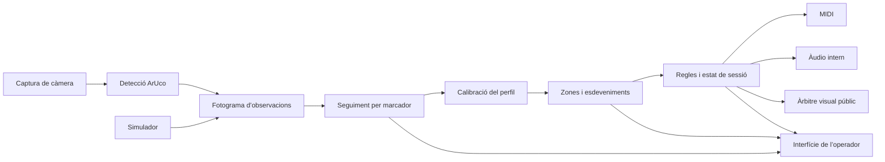

# ATMO ESFERA FX — auditoria i proposta d’arquitectura

Data de l’auditoria: 31 d’octubre de 2026. Estat original: **proposta abans d’aprovació; cap funció nova en l’entrega d’auditoria**.

Actualització posterior: Jordi ha aprovat l’arquitectura i la fase 1A. Vegeu l’[entrega de la fase 1A, versió 4.7.5](ATMO_ESFERA_FX_FASE_1A.md). La resta d’aquest informe conserva la proposta i les observacions de la base 4.7.4.

Continuació: la [fase 1B, versió 4.7.6](ATMO_ESFERA_FX_FASE_1B.md), afegeix el registre de participants, els estats consultables i els esdeveniments passius. MIDI i visuals continuen pel camí existent.

La [fase 2, versió 4.7.7](ATMO_ESFERA_FX_FASE_2.md), incorpora el simulador separat de cinc participants amb una sessió virtual independent, el mateix contracte d’observacions i cap canvi de sortides reals.

La [fase 3, versió 4.7.8](ATMO_ESFERA_FX_FASE_3.md), adapta el motor de zones al flux comú per a tots els marcadors, amb esdeveniments i zones consultables per participant i proves sobre una còpia virtual del mapa. Les sortides existents es mantenen pel camí de compatibilitat.

La [fase 4, versió 4.7.9](ATMO_ESFERA_FX_FASE_4.md), incorpora regles declaratives, prioritats i propietat visual, notes compartides i CC en canals reservats, configuració versionada i sortides de prova independents al simulador.

La [fase 5A, prototip 4.8.0](ATMO_ESFERA_FX_FASE_5.md), afegeix àudio local opcional i BOSC VIU de prova, validats a Linux amb SDL `dummy`. La validació Windows/dispositiu físic exigida per la fase 5 continua pendent; el backend no es declara definitiu ni obligatori.

Document de requisits: [document mestre](ATMO_ESFERA_FX_DOCUMENT_MESTRE.md), especialment l’apartat 25. Aquesta revisió lliura els punts A–G que demana, sense reescriure l’aplicació ni canviar-ne la marca encara.

La base inspeccionada és **Wasteland Machine 4.7.4**, commit `bde3ccac6cf25d14e3078b192eb41d26c1cb0ede`, a la branca `codex/wasteland-camera-windows-launcher`. El nom del fitxer principal conserva «4.5.15 pas 15», però `APP_VERSION` és 4.7.4. No s’ha de partir de la còpia pas 14 ni assumir que `main` contingui les últimes entregues.

**Recomanació:** conservar la 4.7.4 com a referència recuperable, reutilitzar els mòduls espacials i introduir primer un model comú de detecció i seguiment en paral·lel amb el camí actual. No començar pel canvi d’estètica ni pel motor de joc.

## A. Inventari del codi existent

### Components reutilitzables

| Component | Evidència al codi actual | Què podem reaprofitar i què falta |
|---|---|---|
| Aplicació i interfície | `wasteland_4_5_15_pas_15_editor_musical_desplegable.py`, classe `App`, aproximadament 1.900 línies | Tkinter, finestres, noms de targetes, distribució desada, diagnosi, editor i taula de volums. Captura, lògica i presentació encara conviuen a la mateixa classe. |
| Captura i detector | `App.toggle_cam`, `App.tick`, `cv2.aruco.ArucoDetector` | Una càmera, selecció d’índex, backend DirectShow a Windows, diccionari `DICT_4X4_50`, processament de tots els IDs 0–15 detectats. Cada detecció activa directament funcions de la targeta. No hi ha un contracte independent de fotograma/detecció ni mesura calibrada de qualitat. |
| Seguiment actual | `active`, `last_seen`, `target_trails`, `expire_missing_cards` | Posició, rotació i historial recent per ID; retirada després de 250 ms sense veure’l. No hi ha registre de participants separat del marcador ni els estats de sessió demanats. |
| MIDI i música | `harmony_pitches`, `arpeggio_note`, `sequencer_tick`, `drum_tick` i configuracions de targetes | Notes, harmonies, arpegis en quatre direccions, patrons de 16 passos, bateria completa, CC i rellotge intern. El fil del seqüenciador evita dependre del ritme de dibuix. No hi ha sincronització automàtica amb el transport de Sonar ni Kaoss XY. |
| Àudio actual | `trigger_audio`, `audio_tick`, `send_audio_controls` | Dispar de clips externs amb nota curta, bloqueig temporal configurat i controls MIDI d’àudio. **No és un reproductor local de fitxers** ni coneix el final real d’un clip de Sonar. |
| Mute i diagnòstic | `send_mute_state`, `sync_mute_controls`, `TracedMidiOutput` | Control absolut configurable per CC, deduplicació i reintent d’errors. En aquesta conversa s’ha verificat al receptor: CC119, canal 1, 0 desmuteja i 127 muteja; repetir un valor manté l’estat. No cal tornar a atribuir aquest cas només a Note On/Off. El registre confirma acceptació local, no recepció remota. |
| Superfície i zones | `spatial_zones.py`: `Grid`, `Zone`, `SpatialMap`, `SpatialEngine` | Cercle normalitzat, graella 8×8, agrupació, autoritzacions, validació de solapaments, entrada/sortida confirmades i histèresi. Amb el cercle actual, 60 caselles són elegibles; les quatre cantonades completament exteriors es descarten. No és encara un motor general de regles. |
| Editor espacial | `spatial_zone_editor.py` | Crear, editar i eliminar zones; assignar una fotografia per zona, autoritzar marcadors, configurar durada i desar. Agrupar caselles comparteix fotografia; una fotografia per casella requereix zones separades. Falten sons, accions generals i colors d’edició configurables. |
| Calibració | `spatial_zones.Calibration`, `spatial_calibration.py` | Homografia de quatre correspondències, captura congelada, punts nord/est/sud/oest i guia circular o de quatre costats. Valida geometria i guarda punts al projecte. **No calibra la lent, l’alçada del barret ni la projecció sobre la cúpula.** |
| Visuals i fotografies | `spatial_projection.py`, `compose_output_frame`, `projector_frame`, `live_preview_frame` | Memòria cau limitada, JPG/PNG, proporcions preservades, transparència sobre negre, prioritat zona/color i separació de guies de l’operador. Dotze visuals generatius i color cromàtic. No hi ha escenes configurables generals, vídeo de contingut ni text públic configurable. |
| Durada d’imatges | `Zone.display_mode`, `duration_s`, `ZoneProjection` | Persistent; mentre la targeta sigui a la zona; segons després de retirar-la. Tornar a la zona cancel·la el compte enrere. En acabar, negre. Aquesta decisió recent continua vigent encara que el document mestre destaqui només la persistència. |
| Projectes | `save_project`, `open_project`, `SpatialMap.to_dict/from_dict`, `rebase_map_images` | JSON arrel `version: 4`, bloc espacial `schema_version: 1`; rutes relatives quan és possible i compatibilitat amb JSON antics. Falten manifest de recursos, paquets d’experiència, plantilles, importació/exportació i migració transaccional completa. |
| Simulació | Mètodes `simulation_*` i proves sintètiques | Existeix un camí intern per a una targeta i APIs de coordenades de terra per provar zones. Els controls de ratolí es van retirar de la interfície a petició de Jordi. **No hi ha un simulador visible de cinc participants.** El nou ha de ser una eina separada de l’operador. |
| Arrencada i recursos | Dos BAT, `requirements.txt`, capçalera PNG | Python 3.12, Tkinter, NumPy, OpenCV headless amb ArUco, Pillow, Mido i python-rtmidi. loopMIDI i Sonar són externs. L’accés estable comprova els mòduls i prepara un entorn virtual. |

### Verificació efectuada

S’han tornat a executar les **103 proves**, totes correctes i sense omissions, amb Python 3.12 i pantalla virtual Xvfb. Inclouen càmera ArUco sintètica, interfície Tkinter, música, Mute, diagnosi, zones, calibració, recursos i durades.

Aquesta auditoria no valida de nou Windows, el BAT, loopMIDI, Sonar, barrets físics, cobertura de càmera ni projector. Jordi ha comunicat que la calibració circular i l’activació de fotografies funcionen en les seves proves; això és evidència d’ús, no una mesura de precisió amb persones de diferents alçades.

### Punts que condicionen la transformació

1. `App.tick` llegeix la càmera i detecta marcadors al fil de Tkinter: una lectura lenta pot bloquejar la interfície. El fil musical ja està separat; no s’ha de desfer aquesta separació.
2. Les zones reben només els IDs amb funció **Activar zona espacial**. Un motor de regles futur ha de poder observar tots els marcadors, sense exigir canviar-ne la funció musical ni activar-la accidentalment.
3. El motor espacial genera esdeveniments per marcador, però la sortida pública actual té una sola escena guanyadora. Les accions de tots els participants han de processar-se abans d’arbitrar què es projecta.
4. Hi ha especialitzacions d’ID, especialment la targeta 02 amb CC7 i filtre CC74. Cal conservar-les com a compatibilitat i convertir-les més endavant en configuracions assignables.
5. Hi ha una ruta cromàtica plana, però `compose_live_visuals` també permet mescla de capes. Abans de generalitzar escenes cal garantir un únic àrbitre: una ordre de color públic ha de produir color uniforme fins que una altra ordre autoritzada la substitueixi.
6. El desament escriu directament el JSON. L’obertura valida el bloc espacial, però no tota la configuració abans de modificar l’estat. Cal preveure validació completa i escriptura atòmica en l’increment de projectes.
7. `OBRIR_WASTELAND.bat` invoca `pip install` en cada arrencada. Cal separar instal·lació i execució i provar l’arrencada offline amb dependències ja instal·lades. L’aplicació no necessita serveis d’Internet per detectar o enviar MIDI.
8. `LLEGEIX-ME.md` i `DIAGNOSI_MUTE_SONAR.md` contenen instruccions històriques, inclosa simulació visible i diagnosi anterior al control CC. No s’han de prendre totes com a descripció de la 4.7.4. `MAPA_ZONES.md` registra les entregues espacials posteriors.

## B. Arquitectura proposada

Mantenir **un sol programa Python modular**, sense microserveis ni canvi de framework. Tkinter continua sent la interfície inicial. Els mòduls actuals no es reescriuen tots de cop: s’hi introdueixen adaptadors amb contractes petits.

| Subsistema | Responsabilitat i contracte proposats |
|---|---|
| Captura | Fotograma amb font, seqüència, hora monotònica i estat `ok` o `unavailable`. Distingir càmera avariada d’imatge vàlida sense marcadors. Un únic propietari de la càmera; cua limitada a l’últim fotograma quan s’extregui del fil Tk. |
| Detecció | Retornar totes les observacions d’una imatge: ID, centre normalitzat de càmera, cantonades i orientació. No enviar MIDI ni accedir a widgets. Àrea o mida del marcador són indicadors geomètrics, no una probabilitat de certesa inventada. |
| Seguiment | Una identitat física estable per `(font, ID)`, observació recent, estat detectat/perdut temporalment/absent i historial limitat. Retirar una persona de la sessió és una ordre explícita, no una conseqüència d’un fotograma perdut. |
| Participants | Registre separat amb ID intern, nom, color i vinculació a un marcador. En Table la mateixa vinculació pot identificar un objecte. Les vides, els punts o l’objectiu pertanyen al joc, no al detector. |
| Calibració | Transformar coordenades etiquetades: càmera, pla aproximat dels marcadors i terra. Guardar el perfil físic, referències, resolució i dades necessàries; no confondre’ls amb píxels de previsualització. Reutilitzar `Calibration` per al cas pla. |
| Superfícies | Reutilitzar `Grid`, `Zone` i `SpatialEngine`. Dome circular inicial; Table rectangular/circular en el seu increment. L’API ja normalitzada del simulador és explícita i no substitueix la calibració física. |
| Esdeveniments | Dades immutables amb tipus, temps, seqüència, origen, marcador/participant i zona quan calgui. Separar aparició, desaparició confirmada, entrada, sortida i incidència de font. Més endavant: permanència, moviment, rotació i proximitat. |
| Regles | Condicions sobre esdeveniments i estat; accions declaratives tipades. Sense executar codi Python escrit als projectes. Prioritats explícites, deduplicació i ordre determinista; una regla pot generar diverses accions. |
| MIDI | Adaptador al camí actual, incloent notes pendents, canvis, retirada, seqüenciació, errors i emergència. El rellotge musical conserva el seu fil. Introduir la propietat de notes per evitar que una acció apagui la nota d’una altra. |
| Àudio | Interfície reproduir/aturar/grup/volum/fade amb identificadors de veus. Backend local opcional; mantenir en paral·lel els dispars i controls a Sonar. No dir «ha acabat» a partir d’un temporitzador de bloqueig MIDI. |
| Visuals | Un propietari explícit de la sortida pública i ordres amb prioritat. Reutilitzar càrrega i memòria cau. Separar el contingut net dels overlays de l’operador. Respectar persistència, presència i retard de retirada. |
| Joc i sessió | Màquina d’estats, participants registrats, rellotge pausables i historial d’operador. Les pèrdues dubtoses no treuen vides. Les correccions de penalització han de quedar registrades i ser reversibles. |
| Projectes i recursos | Validació, versions, migració, rutes i manifest. Només configuració; no serialitzar temps monotònics, notes premudes o estat transitori de detecció. |
| Interfície i diagnòstic | Tkinter consumeix instantànies i envia ordres d’operador. Els treballadors no modifiquen widgets. Registres limitats amb detecció, regla i acció relacionades; simular i diagnosticar no són una nova sortida pública. |

Contractes mínims proposats: `ObservationFrame`, `MarkerObservation`, `MarkerState`, `ParticipantBinding`, `DomainEvent`, `ActionRequest`, `OutputState` i `ExperienceConfig`. S’introdueixen quan toca, no tots a la primera tasca. Les dependències van de dades cap als adaptadors; el seguiment no importa Tkinter, Mido ni el reproductor d’àudio.

**Prioritat visual:** una ordre només reclama la sortida quan es confirma; l’actualització d’un color no recupera la sortida a cada fotograma. Primer prioritat configurada, després seqüència temporal de confirmació i, en empat, ordre estable de regla/ID. No s’ha d’emetre un fotograma negre transitori si en el mateix lot hi ha una ordre nova guanyadora. Els valors inicials es migraran de les regles actuals; una alarma només tindrà més prioritat si l’experiència ho configura.

**Àudio local:** fer una prova de concepte Windows amb un adaptador de `pygame-ce`/SDL_mixer per a WAV/OGG, canals independents i fades; no afegir encara una dependència obligatòria. Cal mesurar latència, consum de memòria, superposició, retirada i pèrdua del dispositiu. Els ambients llargs poden requerir streaming: no donar per bona la càrrega de tots els sons a RAM ni basar totes les capes en un únic reproductor global. El resultat d’aquesta prova determinarà el backend definitiu.

## C. Sistema de barrets: límits, calibració i proves

### Què canvia respecte de les targetes al terra

La càmera veu el marcador del cap, no els peus. En perspectiva, elevar-lo desplaça la seva projecció aparent cap a fora del centre òptic. La detecció d’ID pot ser correcta i la zona del terra equivocada. Una càmera superior central redueix desplaçaments i ocultacions respecte d’un muntatge lateral, però no els elimina.

En un model ideal, càmera vertical a alçada `H`, marcador a alçada `h` i distància horitzontal real al centre `r`, aplicar una homografia del terra dona aproximadament:

`r_aparent = r × H / (H − h)`

L’error radial és `r × h / (H − h)`. Exemple només il·lustratiu: `H=5 m`, `h=1,7 m`, `r=2 m` produeix uns **1,03 m** d’error si s’assumeix que el marcador és al terra. No són mesures de la teva instal·lació. La inclinació, la lent i la posició exacta de la càmera exigeixen un model més complet.

Si calibrem en un pla de marcadors a alçada de referència `h0`, l’error ideal per diferència d’alçada és `r × (h − h0) / (H − h)`. La millora no és una garantia de precisió: encara cal mesurar-la. També hi ha desplaçament entre cap i peus quan la persona s’inclina.

### Recomanació de calibració per passos

1. **Mesurar i fixar el muntatge:** superfície útil, alçada de càmera, orientació, resolució i camp visible. Conservar separadament la calibració de terra existent; no substituir-la silenciosament.
2. **Calibrar la lent**, si la distorsió és apreciable, amb diverses vistes d’un patró conegut a la resolució d’execució. Desdistorsionar abans d’aplicar coordenades i homografies, tant les referències com les observacions.
3. **Primer prototip Dome:** posar el centre d’un marcador sobre referències físiques conegudes a una alçada semblant a la dels barrets. Calibrar aquest pla i etiquetar-lo com a pla de marcadors. No són quatre clics sobre persones en posicions desconegudes.
4. **Validar diferents alçades i extrems.** Si la variació supera la tolerància útil, usar intrínsecs i pose de càmera per projectar el raig sobre un pla d’alçada coneguda/estimada per participant. Aquesta intersecció dona la posició del marcador; estimar els peus continua necessitant una convenció i tolerància.
5. **Definir una zona d’incertesa** a les fronteres i confirmar permanència. No convertir una coordenada dubtosa en una penalització irreversible. Si no s’arriba a la precisió requerida, augmentar zones/marges, canviar òptica o muntatge abans de plantejar més càmeres.

La guia circular recent és útil per verificar el contorn, però no resol el paral·laxi dels barrets. Tampoc és una calibració de mapping/warping per projectar sobre la volta del domo.

### Proves físiques necessàries

| Prova | Dades que cal registrar | Decisió que permet prendre |
|---|---|---|
| Referències espacials | Centre i diversos punts mesurats a diferents radis, fronteres i extrems; posició real i estimada | Error mitjà, percentil 95, màxim i direcció de l’error; mida mínima de zona i marge. |
| Alçades | Diverses alçades representatives del grup, amb el marcador sobre la mateixa referència | Si basta un pla comú o cal compensació per persona. |
| Òptica i barrets | Diverses mides d’impressió, inclinacions, girs, llum real i reflexos | Mida del marcador i cobertura útil; punts cecs o orientacions que es perden. |
| Cinc persones | Simultànies, creuaments, proximitat i ocultacions | Taxa de detecció per ID, identitats estables, temps de recuperació i zones no fiables. No prometre 16 simultanis sense prova. |
| Moviment | Caminada, canvis de direcció i entrada lenta a fronteres | Latència d’entrada/sortida, activacions repetides i adequació de filtres. |
| Incidències | Tapar un marcador, desconnectar/reobrir càmera i interrompre MIDI | Distingir pèrdua individual de fallada de font, mantenir participants i recuperar sortides sense notes penjades. |
| Càrrega completa | Cinc participants amb MIDI, visuals i àudio durant una sessió llarga | Temps per fotograma, resposta de l’operador, memòria, CPU i latència de sortida. |

Els llindars físics d’acceptació s’han de triar a partir de la mida de les zones i l’ús: no és el mateix explorar una fotografia que penalitzar una trampa estreta. Fins que no es mesurin, només es poden aprovar els contractes i les proves sintètiques.

## D. Estratègia de compatibilitat

- **Base estable recuperable:** conservar el ZIP del commit `bde3cca` i una carpeta d’execució separada amb projectes i recursos propis. La còpia pas 14 és històrica, però no substitueix el rescat de les millores de la 4.7.4. Aquesta entrega documental no modifica el programa ni incrementa `APP_VERSION`.
- **Primer adaptadors, després substitució:** les observacions noves s’observen en paral·lel, sense executar dues vegades MIDI o visuals. Cada subsistema es connecta quan passa les proves de paritat. Evitar dos temporitzadors actuant sobre la mateixa escena.
- **Mateixes entrades inicials:** conservar noms interns, BAT, fitxers, IDs, canals, notes, funcions de targeta, rellotge i configuracions desades. La marca pública canviarà en una entrega pròpia, amb els recursos complets.
- **JSON actuals:** continuar obrint el format arrel 4 i el bloc espacial 1. Una futura experiència tindrà format/versionat explícits, perfil físic, participants, regles i manifest de recursos. La primera migració crearà una còpia nova i un informe; mai sobreescriurà l’original. Conservar també camps antics no reconeguts quan es puguin preservar.
- **Recursos portables:** cada imatge/so es referenciarà per ID i ruta relativa dins del paquet. Importar/exportar haurà d’incloure’ls i avisar dels absents. Validar el projecte complet abans de canviar la sessió activa; escriure a un temporal i substituir el fitxer només quan el desament acaba correctament.
- **Sonar continua disponible:** loopMIDI, el dispar de clips i Mute CC segueixen operatius. El nou motor d’àudio és addicional. L’aturada general futura distingirà notes pròpies, àudio intern i transport extern; no afirmar que s’atura Sonar només perquè s’han enviat All Notes Off.
- **Una experiència, diverses persones:** un ID de marcador no es reassigna automàticament a una persona nova per una pèrdua de detecció. Les autoritzacions actuals per marcador es poden adaptar al registre de participants mantenint el comportament original.
- **Estabilitat abans d’estètica:** mateixos resultats de les proves actuals, recursos inclosos, versió visible i instruccions d’arrencada verificables. Preparar instal·lació de dependències una vegada i arrencada posterior sense xarxa.

## E. Full de ruta proposat

Les fases següents són d’**ATMO**; no s’han de confondre amb les fases espacials ja completades. Cada entrega ha de tenir una prova de sortida, versió i punt de recuperació.

| Ordre | Increment | Criteri per avançar |
|---|---|---|
| 0 | Aquesta auditoria i aprovació | Inventari real, límits i primer increment revisats. |
| 1A | Observacions i seguiment comú en paral·lel | Cinc IDs independents; cap canvi en MIDI/visuals. Detall a F. |
| 1B | Participants, estat de font i esdeveniments comuns | Distingir persona/marcador, detectar pèrdua temporal i font no disponible sense eliminar ningú. |
| 2 | Simulador separat per a cinc participants | Mateix contracte d’entrada; moure, girar, ocultar, retirar i recuperar cada participant; registre de successos. Sense reintroduir controls sota la previsualització actual. |
| 3 | Adaptar les zones existents al flux comú | Tots els marcadors generen esdeveniments, amb la mateixa histèresi, autoritzacions i durada d’imatges. Sense duplicació de MIDI. |
| 4 | Regles mínimes i propietat de sortides | Entrada/sortida/ordre manual → imatge, color, nota o CC. Prioritat i deduplicació provades; dades separades del codi. |
| 5 | Àudio local i BOSC VIU mínim | Prova de backend Windows superada; diverses capes amb volum/fade i una interacció completa configurable. |
| 6 | Kaoss XY | Instrument/efectes, quatre presets, paràmetres personalitzables, zona morta, suavització, rotació desactivable i retirada sense notes penjades. |
| 7 | Joc EL BOTÍ amb cinc simulats | Estats, pausa, penalitzacions reversibles, objectiu configurable, victòria/derrota i cap penalització per simple pèrdua dubtosa. |
| 8 | Validació Dome amb barrets | Pla correcte, error mesurat, cobertura, latència, marges i incidències comprovats. Les mesures inicials de C poden començar abans, en paral·lel al desenvolupament. |
| 9 | Perfil Table | Superfície i calibració pròpies, amb el mateix seguiment, regles i accions. |
| 10 | Gestor complet i marca pública ATMO ESFERA FX | Plantilles, duplicar, manifest, importar/exportar i paquet offline. Migracions i recuperació provades. |

El contracte de dades d’experiència s’esbossarà a les fases 1B–4; no s’ha d’esperar a la fase 10 per versionar-lo. La fase 10 és el gestor complet, no el primer desament. Vídeo, OSC, àudio espacial i múltiples càmeres/projectors queden fora dels primers increments.

## F. Primera tasca concreta proposada: fase 1A

**Objectiu:** obtenir una llista comuna i verificable de marcadors observats i el seu estat, sense canviar encara què sona ni què es projecta.

Abast petit:

1. Afegir un mòdul de dades/seguiment independent amb `MarkerObservation`, `ObservationFrame` i `MarkerState`. ID físic, font, posició normalitzada de càmera, orientació, temps monotònic i seqüència. Cap camp ha de fingir que és una coordenada de peus.
2. Aïllar la conversió del resultat ArUco actual a aquest model. Una observació no conté funció musical. Rebutjar IDs duplicats en un fotograma amb un diagnòstic clar, sense substituir silenciosament una persona per una altra.
3. Fer que `App.tick` lliuri les observacions al nou seguiment **en paral·lel** i continuï usant el camí existent per enviar MIDI i dibuixar. Una font `unavailable` és diferent de `ok` amb zero observacions. El nou estat només s’inspecciona amb proves/diagnòstic de desenvolupament, sense afegir finestres.
4. Mantenir historial limitat i estats detectat/perdut temporalment/absent. Conservar l’última posició marcada com a antiga, no com a detecció actual. No implementar joc, proximitat, compensació de barrets, regles, reproductor local, nou gestor ni canvi de marca.

Criteris d’acceptació:

- Cinc IDs del 0 al 4 es processen en el mateix fotograma i mantenen posicions i identitats independents.
- Reordenar la llista del detector no intercanvia identitats; una pèrdua breu i retorn no crea un participant nou ni duplica activacions existents.
- Un fotograma buit, una incidència de càmera i una retirada explícita no es confonen. En aquesta fase no existeixen victòries, derrotes ni penalitzacions automàtiques.
- Temps no creixents, valors no finits, IDs fora de rang o duplicats es rebutgen abans de modificar parcialment l’estat.
- Mides d’historial i estat estan limitades; no es conserven imatges completes per participant.
- Les mateixes seqüències sintètiques produeixen **els mateixos missatges MIDI** i contingut públic que en la 4.7.4: notes, retirada, arpegis, Mute, color net i durades de zona. El nou seguiment no envia missatges.
- Les 103 proves de referència continuen correctes, amb proves noves del model i d’integració. Fer una prova manual curta a Windows abans de convertir aquest camí en autoritat.

**Reversibilitat:** cap migració de projecte ni dependència nova. Es pot desconnectar el punt d’observació en paral·lel i tornar al commit estable; les dades de Jordi no s’han transformat. Aquesta tasca queda proposada, no executada, fins a l’aprovació que demana el document mestre.

## G. Decisions pendents

No cal respondre totes aquestes dades per aprovar la fase 1A. El model de detecció i les proves sintètiques poden començar sense mesures de la cúpula. Les decisions següents són les que sí condicionen els increments físics o funcionals posteriors:

| Dada necessària | Quan és necessària |
|---|---|
| Diàmetre de la zona útil, alçada i posició de càmera, inclinació, model/òptica i resolució prevista | Abans de concretar calibració Dome i cobrir tot el perímetre. |
| Rang d’alçades dels participants, mida real dels marcadors i manera de fixar-los als barrets | Abans de triar pla de marcadors, compensació geomètrica i proves de cobertura. |
| Què representa la posició del participant: centre del marcador projectat, aproximació del cos o posició dels peus; mida mínima de zona i error tolerable | Abans de dissenyar trampes i decidir si la precisió mesurada és acceptable. |
| Nombre màxim simultani que es vol validar inicialment | Cinc és la base proposada pel document; confirmar només si la primera instal·lació en necessita més. |
| Dispositiu de sortida d’àudio, formats dels sons, durades d’ambients i capes simultànies esperades | Abans de seleccionar el backend local i el seu model de streaming/memòria. |
| Superfície, dimensions i muntatge de càmera/projecció de Table | Abans d’implementar-ne el perfil físic; no bloqueja Dome. |
| Regles concretes d’EL BOTÍ: condició de victòria, penalitzacions reversibles i tractament d’una incidència de seguiment | Abans de la fase de joc, després de provar el seguiment. |

Ja estan decidits i no cal tornar-los a preguntar: català, Python 3.12/Windows inicial, mantenir Sonar/MIDI, barrets ArUco en Dome, separació operador/públic i possibilitat de persistència o durada després de retirar una targeta. Les qüestions de disseny rutinàries —tipus immutables, registres limitats, prioritat determinista— es resolen amb la proposta anterior i proves.

## Entrega i aprovació

Aquesta entrega només incorpora el document mestre i aquest informe. **Wasteland continua sent la 4.7.4**; no cal descarregar una altra versió del programa ni executar PowerShell per revisar la proposta.

L’apartat 25 del document mestre diu: «**Espera l’aprovació de l’arquitectura i de la primera fase.**» Per això el següent pas requereix aprovar l’arquitectura modular de B i la fase 1A de F. L’aprovació no implica iniciar alhora totes les funcions futures.
